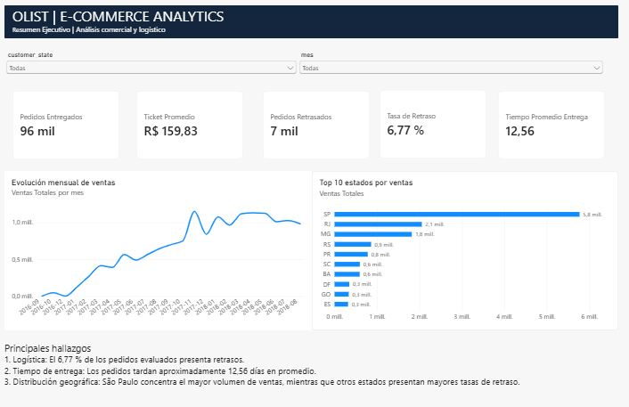
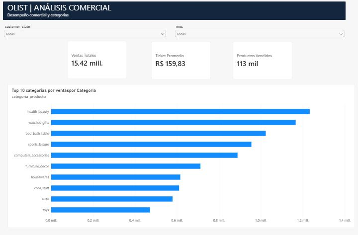
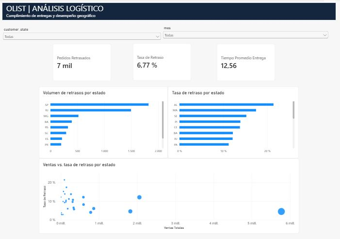

# Olist E-commerce Analytics | Python & Power BI

## Descripción del proyecto

Proyecto de análisis de datos comerciales y logísticos basado en el conjunto de datos público **Brazilian E-Commerce Public Dataset by Olist**, disponible en Kaggle.

El objetivo es transformar datos transaccionales en información útil para evaluar el desempeño comercial, identificar patrones de compra, analizar la eficiencia de las entregas y detectar oportunidades de mejora mediante **Python y Power BI**.

El proyecto abarca la exploración, limpieza, transformación, análisis y visualización de datos, integrando indicadores comerciales, geográficos, temporales y logísticos.

## Objetivos

- Analizar el desempeño comercial de una plataforma de comercio electrónico.
- Evaluar la eficiencia logística y el cumplimiento de las fechas estimadas de entrega.
- Identificar patrones de ventas por ubicación geográfica y categoría de producto.
- Examinar la evolución temporal de los pedidos y las ventas.
- Construir un dashboard interactivo que facilite el análisis y la toma de decisiones.

## Herramientas utilizadas

| Herramienta | Aplicación |
|---|---|
| Python | Procesamiento, limpieza y análisis de datos |
| Pandas | Manipulación, transformación y agregación de datos |
| NumPy | Operaciones numéricas |
| Power BI | Modelado de datos y visualización interactiva |
| DAX | Construcción de medidas e indicadores |
| Power Query | Preparación y transformación de datos |
| Visual Studio Code | Desarrollo y ejecución de scripts |
| Git y GitHub | Control de versiones y publicación del proyecto |

## Indicadores principales

Los resultados del análisis incluyen:

| Indicador | Resultado aproximado |
|---|---:|
| Ventas totales de pedidos entregados | R$ 15.42 millones |
| Pedidos entregados | 96,478 |
| Ticket promedio por pedido entregado | R$ 159.83 |
| Pedidos entregados con retraso | 6,534 |
| Tasa de retraso | 6.77% |
| Tiempo promedio de entrega | 12.56 días |

**Consideraciones metodológicas:**

- Las ventas incluyen el valor de los productos y el costo de envío de los pedidos entregados.
- El ticket promedio se calcula dividiendo las ventas totales entre los pedidos entregados.
- La tasa de retraso utiliza como denominador los pedidos con información válida para evaluar el cumplimiento logístico.
- El tiempo promedio de entrega se calcula a partir de los pedidos con duración de entrega válida.

## Metodología de análisis

### 1. Exploración y limpieza de datos

Se analizaron los conjuntos de datos originales de Olist para identificar:

- Valores faltantes.
- Registros duplicados.
- Tipos de datos.
- Estados de los pedidos.
- Inconsistencias cronológicas.
- Variables relevantes para el análisis.

Se prepararon archivos procesados que sirven como base para las siguientes etapas.

### 2. Análisis logístico

Se construyeron indicadores para evaluar el proceso de entrega de pedidos.

Entre las principales variables analizadas se encuentran:

- Tiempo total de entrega.
- Tiempo de transporte.
- Cumplimiento de la fecha estimada.
- Días de retraso.
- Distribución de pedidos retrasados.
- Valores atípicos en los tiempos de entrega.

### 3. Análisis comercial y geográfico

Se analizaron las operaciones comerciales considerando:

- Distribución geográfica de pedidos.
- Ventas por estado.
- Categorías de productos.
- Desempeño de vendedores.
- Concentración de ventas.

### 4. Análisis temporal

Se estudió la evolución de los indicadores a lo largo del tiempo, incluyendo:

- Ventas mensuales.
- Evolución de pedidos.
- Comportamiento logístico mensual.
- Métodos de pago.
- Repetición de clientes.
- Conciliación de indicadores financieros.

### 5. Visualización en Power BI

Se desarrolló un dashboard interactivo de tres páginas para presentar los resultados del análisis.

## Dashboard interactivo

### Página 1. Resumen Ejecutivo

Presenta una visión general del desempeño comercial y logístico mediante indicadores clave.



### Página 2. Análisis Comercial

Permite explorar la distribución de ventas y pedidos, así como el desempeño comercial por diferentes dimensiones.



### Página 3. Análisis Logístico

Evalúa el cumplimiento de las entregas, los tiempos logísticos y la distribución de los retrasos.



## Principales hallazgos

**1. Predominio de entregas anticipadas**

La mayor parte de los pedidos con información logística válida se entregó antes de la fecha estimada.

**2. Diferencias geográficas en el desempeño logístico**

São Paulo concentra un volumen importante de pedidos, mientras que Río de Janeiro presenta una tasa de retraso relativamente mayor.

**3. Importancia de evaluar el cumplimiento logístico**

Aunque la tasa general de retraso es relativamente baja, existen diferencias entre ubicaciones y pedidos que justifican un análisis segmentado.

**4. Relación entre desempeño comercial y eficiencia operativa**

El análisis conjunto de ventas, pedidos y tiempos de entrega permite identificar áreas prioritarias para mejorar el servicio y apoyar la toma de decisiones.

## Estructura del proyecto

```text
Olist-Ecommerce-Analytics/
│
├── Dashboard/
│   └── Olist_Ecommerce_Analytics_Dashboard.pbix
│
├── notebooks/
│   ├── 01_exploracion_inicial.py
│   ├── 02_analisis_logistico.py
│   ├── 03_analisis_comercial_geografico.py
│   └── 04_analisis_temporal.py
│
├── images/
│   ├── 01_resumen_ejecutivo.png
│   ├── 02_analisis_comercial.png
│   └── 03_analisis_logistico.png
│
├── data/
│   ├── raw/
│   └── processed/
│
├── .gitignore
├── requirements.txt
└── readme.md
```

Las carpetas `data/raw/` y `data/processed/` se utilizan durante la ejecución local del proyecto. Sus archivos CSV no se publican en el repositorio.

## Instalación y ejecución

### 1. Clonar el repositorio

```bash
git clone https://github.com/oscarhleco04/-Olist-Ecommerce-Analytics.git
cd -- -Olist-Ecommerce-Analytics
```

### 2. Instalar dependencias

Se requiere Python 3.

```bash
python -m pip install -r requirements.txt
```

### 3. Descargar los datos originales

Descargar el conjunto de datos **Brazilian E-Commerce Public Dataset by Olist** desde Kaggle:

https://www.kaggle.com/datasets/olistbr/brazilian-ecommerce

Crear la carpeta `data/raw/` dentro del proyecto y colocar allí los archivos CSV originales.

Los datos originales no están incluidos en este repositorio.

### 4. Ejecutar los scripts

Desde la carpeta principal del proyecto, ejecutar los scripts en el siguiente orden:

```bash
python notebooks/01_exploracion_inicial.py
python notebooks/02_analisis_logistico.py
python notebooks/03_analisis_comercial_geografico.py
python notebooks/04_analisis_temporal.py
```

Cada script realiza una etapa del procesamiento y genera archivos para los análisis posteriores.

Los resultados se guardan en:

```text
data/processed/
```

### 5. Visualizar el dashboard

Abrir el archivo:

```text
Dashboard/Olist_Ecommerce_Analytics_Dashboard.pbix
```

Se requiere **Power BI Desktop** para visualizar e interactuar con el dashboard.

El archivo `.pbix` contiene el modelo y las visualizaciones desarrolladas. Si se desea actualizar la información, será necesario configurar las rutas de origen de los datos en Power BI.

## Reproducibilidad

El procesamiento se organiza en cuatro scripts secuenciales:

| Script | Función |
|---|---|
| `01_exploracion_inicial.py` | Exploración, limpieza y preparación inicial |
| `02_analisis_logistico.py` | Construcción de indicadores logísticos |
| `03_analisis_comercial_geografico.py` | Análisis comercial y geográfico |
| `04_analisis_temporal.py` | Análisis temporal y conciliación financiera |

Se realizó una prueba de ejecución desde una carpeta `data/processed/` vacía, verificando la generación secuencial de los resultados.

Los archivos originales y procesados se excluyen del control de versiones mediante `.gitignore`.

## Fuente de datos

**Dataset:** Brazilian E-Commerce Public Dataset by Olist

**Plataforma:** Kaggle

**Enlace:** https://www.kaggle.com/datasets/olistbr/brazilian-ecommerce

El conjunto de datos contiene información histórica de comercio electrónico en Brasil, incluyendo pedidos, clientes, productos, vendedores, pagos y entregas.

## Conclusiones

Este proyecto demuestra la aplicación de técnicas de análisis de datos para convertir información transaccional en indicadores comerciales y logísticos.

La integración de Python y Power BI permite desarrollar un flujo analítico que comprende la preparación de datos, la construcción de métricas y la presentación de resultados mediante visualizaciones interactivas.

El dashboard facilita la identificación de patrones de desempeño, diferencias geográficas y oportunidades de mejora operativa.

## Autor

Proyecto de portafolio profesional desarrollado como aplicación práctica de conocimientos en **Data Analytics, Python y Power BI**.

**Áreas de interés:** análisis de datos, inteligencia de negocios y análisis económico aplicado.